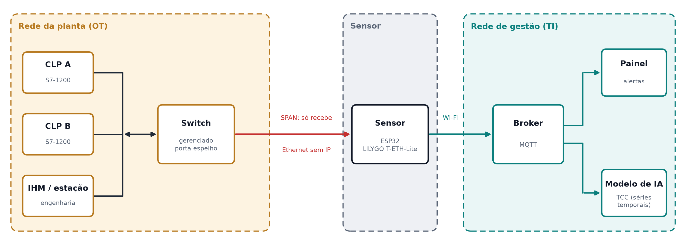
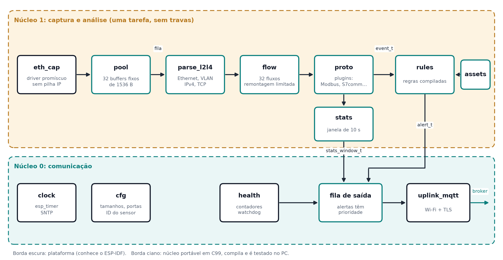
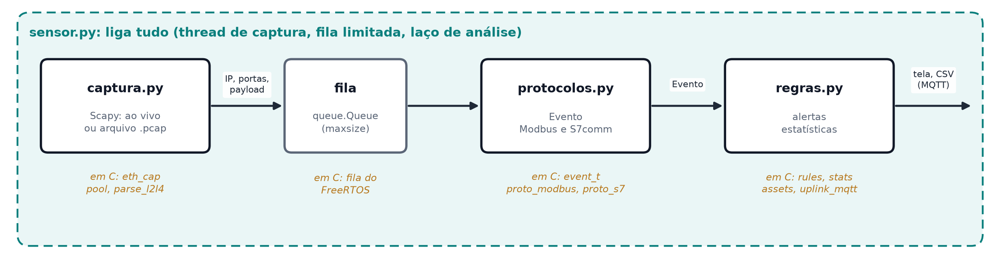

# Arquitetura do Projeto: Sensor Passivo de Tráfego Industrial

Monitoria de Introdução às Redes de Comunicação, UFPE

## 1. Objetivo

Construir um **sensor que escuta a rede da planta sem participar dela**, entende os protocolos industriais que passam por ali (Modbus TCP e S7comm), avisa quando algo foge do esperado e entrega estatísticas para análise posterior.

O documento tem duas partes:

- **Parte A, o sensor real em C:** como o projeto seria feito para rodar num microcontrolador (ESP32) instalado numa planta. É a referência de engenharia.
- **Parte B, a versão de aula em Python:** a mesma ideia em 4 arquivos, escritos com a turma em sala, usando Scapy. Cada parte do código Python aponta para o módulo C equivalente.

O sensor é a primeira peça do TCC "sistema de detecção de intrusão para plantas industriais": ele produz os eventos e as séries que o modelo de detecção vai consumir.

As figuras deste documento são geradas pelo script `figuras.py` (matplotlib). Para alterar uma figura, edite o script e rode `python figuras.py`.

## 2. Onde o sensor fica



| Ligação | Meio | Sentido |
|---|---|---|
| Planta → sensor | Ethernet, porta espelho (SPAN) do switch | **Só recebe.** A interface não tem endereço IP e nenhum módulo transmite por ela. |
| Sensor → broker | Wi-Fi, MQTT | Sensor publica alertas, estatísticas e saúde |
| Broker → painel e modelo de IA | Rede de gestão (TI) | Consumidores assinam os tópicos |

Regra central: **o sensor nunca fala com a rede da planta.** Se ele travar, reiniciar ou for atacado, o processo continua igual ([ADR-001](decisoes/ADR-001-sensor-passivo.md)).

---

# Parte A: o sensor real em C

## 3. Requisitos

| Requisito | Consequência na arquitetura |
|---|---|
| **Passivo** | A Ethernet monitorada fica em modo promíscuo e **sem pilha IP**: não responde ARP, não pede DHCP, não tem rota. Os quadros vão do driver direto para o sensor. |
| **Microcontrolador** (ESP32, ~520 KB de SRAM) | **Nenhuma alocação dinâmica depois da partida.** Pool de quadros, tabela de fluxos e tabela de estatísticas têm tamanho fixo. Quando algo enche, o sensor **descarta e conta**; nunca trava ([ADR-002](decisoes/ADR-002-microcontrolador-memoria-estatica.md)). |
| **2 núcleos** | Núcleo 1 captura e analisa; núcleo 0 cuida de Wi-Fi e MQTT. Os dois só trocam **mensagens copiadas por fila**, sem memória compartilhada e sem travas. |
| **Extensível** | Protocolos entram por uma interface de plugin. Somar DNP3, IEC 104 ou outro não mexe no núcleo ([ADR-005](decisoes/ADR-005-decodificadores-e-plugins.md)). |
| **Testável fora da placa** | O **núcleo** (camadas, fluxos, protocolos, regras, estatísticas) é C99 puro, sem nenhum `#include` do ESP-IDF. Compila no PC e é testado com arquivos `.pcap`. Só a **camada de plataforma** conhece o ESP32. |
| **Seguro por construção** | O decodificador lê bytes enviados por qualquer um na rede, inclusive por um atacante. Todo campo de tamanho é conferido contra o que de fato chegou antes de ser usado. |

## 4. Visão geral



Caminho de um quadro:

1. `eth_cap` recebe o quadro do driver, copia para um buffer do `pool` e põe o ponteiro na fila.
2. A tarefa de análise tira da fila e chama `parse_l2l4` (Ethernet, VLAN, IPv4, TCP).
3. `flow` acha o fluxo TCP, junta o payload no buffer daquele sentido e pergunta ao plugin se já há uma mensagem inteira.
4. O plugin (`proto_modbus`, `proto_s7`) transforma cada mensagem inteira num `event_t`.
5. O evento vai para `rules` (que pode gerar `alert_t`) e para `stats` (que acumula a janela).
6. Alertas e janelas fechadas vão, por cópia, para a fila de saída no núcleo 0; `uplink_mqtt` publica.
7. O buffer volta para o `pool`.

## 5. Módulos

### 5.1 Plataforma (só esta parte conhece o ESP32)

| Módulo | Responsabilidade | Interface principal |
|---|---|---|
| `eth_cap` | Liga o driver Ethernet em modo promíscuo, sem netif e sem IP. A cada quadro, pega um buffer do pool, copia e põe na fila. Se não houver buffer ou a fila estiver cheia, descarta e conta. | `int eth_cap_start(QueueHandle_t q);`<br>`void eth_cap_counters(cap_counters_t *out);` |
| `clock` | Tempo monotônico (`esp_timer`) para medir intervalos; hora real por SNTP via Wi-Fi para carimbar eventos. Informa se a hora já foi sincronizada. | `uint64_t clock_mono_us(void);`<br>`bool clock_wall_us(uint64_t mono, uint64_t *wall);` |
| `uplink_mqtt` | Wi-Fi e cliente MQTT com TLS. Esvazia a fila de saída, serializa em JSON, reconecta sozinho. Se o broker cair, descarta primeiro estatísticas, por último alertas. | `void uplink_task(void *arg);` |
| `health` | Junta os contadores de todos os módulos, a menor memória livre já vista e o tempo ligado; alimenta o watchdog; publica em `.../health`. | `void health_task(void *arg);` |
| `cfg` | Constantes de compilação: tamanhos das tabelas, portas, janela, ID do sensor. Credenciais de Wi-Fi e MQTT ficam na NVS cifrada, nunca no código. | `#define` / `Kconfig` |

### 5.2 Núcleo portável (C99)

| Módulo | Responsabilidade | Interface principal |
|---|---|---|
| `pool` | Buffers de quadro de tamanho fixo (32 × 1536 B). | `pkt_t *pool_get(void);`<br>`void pool_put(pkt_t *p);` |
| `parse_l2l4` | Ethernet (com tag VLAN 802.1Q), IPv4 e TCP. Valida tamanhos; preenche 5-tupla, flags, número de sequência e ponteiro para o payload. Não copia nada. | `int parse_l2l4(const pkt_t *p, frame_info_t *out);` |
| `flow` | Tabela fixa de fluxos TCP (32), com timeout e despejo do mais antigo. Remontagem limitada: buffer de 1 KB por sentido, usa o `frame_len` do plugin para cortar mensagens. Guarda o estado do protocolo por fluxo ([ADR-006](decisoes/ADR-006-remontagem-tcp-limitada.md)). | `flow_t *flow_get(const tuple_t *t, uint64_t ts);`<br>`void flow_feed(flow_t *f, const frame_info_t *fi, msg_cb cb);` |
| `proto` | Registro de plugins; escolhe o decodificador pela porta TCP. | `const proto_t *proto_find(uint16_t port);` |
| `proto_modbus`, `proto_s7` | Os plugins: transformam uma mensagem inteira em `event_t` e casam pergunta com resposta. | ver `proto_t` (seção 6.1) |
| `assets` | Inventário compilado: IP, MAC e papel de cada equipamento (CLP, IHM, estação de engenharia). | `const asset_t *assets_find(uint32_t ip);` |
| `rules` | Tabela de regras compilada; avalia cada evento ([ADR-007](decisoes/ADR-007-regras-compiladas.md)). | `int rules_eval(const event_t *e, alert_t *out, int max);` |
| `stats` | Agrega eventos por janela de 10 s. | `void stats_add(const event_t *e);`<br>`bool stats_flush(uint64_t now, stats_window_t *out);` |

## 6. Interfaces

### 6.1 O plugin de protocolo

É o contrato para somar protocolos. Um plugin é uma `struct` constante com ponteiros de função:

```c
typedef struct proto {
    const char *name;
    uint16_t    tcp_port;                         /* 502 Modbus, 102 S7comm */

    /* Tamanho da próxima mensagem inteira no buffer:
       >0 = tamanho em bytes, 0 = falta chegar mais, <0 = lixo (ressincronizar). */
    int  (*frame_len)(const uint8_t *buf, size_t len);

    /* Decodifica UMA mensagem inteira. Pode ler e atualizar o estado do fluxo.
       Devolve 1 se gerou evento, 0 se não, <0 se a mensagem é malformada. */
    int  (*decode)(const uint8_t *msg, size_t len, msg_dir_t dir,
                   proto_state_t *st, event_t *out);
} proto_t;

static const proto_t *const PROTOS[] = { &PROTO_MODBUS, &PROTO_S7 };
```

**Por que o plugin tem estado por fluxo:** a resposta não repete o que foi pedido. A resposta Modbus à função 3 traz os valores, mas não diz de qual registrador; a resposta S7 a uma leitura não diz qual DB. O plugin guarda as perguntas pendentes (pelo *transaction id* no Modbus, pelo *PDU reference* no S7, até 8 por fluxo) e completa a resposta com o endereço da pergunta. Pergunta sem resposta expira; resposta sem pergunta recebe a marca `UNMATCHED_RESP`.

### 6.2 O evento normalizado

Único formato que regras, estatísticas e MQTT conhecem. Nenhum módulo depois do plugin sabe o que é Modbus ou S7 ([ADR-004](decisoes/ADR-004-evento-normalizado.md)).

```c
typedef enum { OP_READ, OP_WRITE, OP_CONTROL, OP_DIAG, OP_OTHER } op_t;
typedef enum { DIR_REQ, DIR_RESP } msg_dir_t;

typedef struct {
    uint64_t ts_us;                       /* hora real, ou monotônica se SNTP ainda não sincronizou */
    uint32_t src_ip, dst_ip;
    uint16_t src_port, dst_port;
    uint8_t  proto_id;                    /* PROTO_MODBUS, PROTO_S7, ... */
    uint8_t  dir;                         /* msg_dir_t */
    uint8_t  op;                          /* op_t */
    uint8_t  func;                        /* código bruto do protocolo */
    uint16_t area;                        /* Modbus: tabela; S7: número do DB ou área */
    uint32_t addr;
    uint16_t count;
    int16_t  status;                      /* 0 = ok; exceção Modbus ou retorno S7 */
    uint8_t  nvals;
    uint16_t vals[4];                     /* amostra dos valores lidos/escritos */
    uint8_t  flags;                       /* MALFORMED, TRUNCATED, UNMATCHED_RESP, TIME_UNSYNC */
} event_t;
```

`op` é a parte mais importante para segurança: as regras falam em "escrita" e "controle", não em "função 16" ou "função 0x05". Assim uma regra vale para todos os protocolos.

### 6.3 Regra, alerta e janela

```c
typedef struct {
    const char *id;            uint8_t severity;
    uint8_t  proto_id, op;     /* 0xFF = qualquer */
    uint8_t  src_role_not;     /* ex.: dispara se a origem NÃO for ROLE_ENG */
    uint16_t area;             uint32_t addr_lo, addr_hi;
    uint16_t rate_max_per_s;   /* 0 = sem limite de taxa */
} rule_t;

typedef struct { const char *rule_id; uint8_t severity; event_t ev; } alert_t;

typedef struct {
    uint32_t src_ip, dst_ip;   uint8_t proto_id, op, func;
    uint32_t count, errors, bytes;
    uint16_t last_vals[4];     uint8_t nvals;
} stats_entry_t;               /* stats_window_t = início, fim e até 256 entradas */
```

## 7. Decodificação

Os dois protocolos são decodificados à mão. Existem bibliotecas em C para eles, mas são pilhas de comunicação (feitas para *participar* da conversa, como libmodbus e snap7) ou ferramentas grandes demais para um microcontrolador (dissectors do Wireshark, Suricata, Zeek). Ver [ADR-005](decisoes/ADR-005-decodificadores-e-plugins.md).

Todos os números são *big-endian* (o byte mais significativo vem primeiro).

### 7.1 Modbus TCP (porta 502)

| Offset | Tamanho | Campo | Uso no sensor |
|---|---|---|---|
| 0 | 2 | Transaction ID | Casar pergunta e resposta |
| 2 | 2 | Protocol ID | Tem que ser 0; senão, malformado |
| 4 | 2 | Length | Bytes que vêm depois deste campo (Unit ID + PDU). `frame_len = 6 + Length` |
| 6 | 1 | Unit ID | Guardado em `area` alta, se necessário |
| 7 | 1 | Function code | `func`; bit 7 ligado = resposta de exceção |
| 8 | ... | Dados da função | Depende da função |

| Função | Nome | `op` | Pergunta traz | Resposta traz |
|---|---|---|---|---|
| 1, 2 | Read Coils / Discrete Inputs | READ | endereço, quantidade | nº de bytes, bits |
| 3, 4 | Read Holding / Input Registers | READ | endereço, quantidade | nº de bytes, registradores |
| 5 | Write Single Coil | WRITE | endereço, valor (`FF00` liga, `0000` desliga) | eco da pergunta |
| 6 | Write Single Register | WRITE | endereço, valor | eco da pergunta |
| 15 | Write Multiple Coils | WRITE | endereço, quantidade, nº de bytes, bits | endereço, quantidade |
| 16 | Write Multiple Registers | WRITE | endereço, quantidade, nº de bytes, registradores | endereço, quantidade |
| 8, 43 | Diagnostics / Encapsulated (identificação) | DIAG | | |
| outras | | OTHER | | |
| func + 0x80 | Exceção | igual à pergunta | | código de exceção → `status` |

Validação mínima: `Protocol ID == 0`, `2 ≤ Length ≤ 254` (a ADU tem no máximo 260 bytes), e cada campo de quantidade coerente com o número de bytes que realmente chegou.

### 7.2 S7comm (porta 102, ISO-on-TCP)

O S7comm viaja dentro de duas camadas de encapsulamento antes do cabeçalho S7:

| Camada | Offset | Tamanho | Campo | Uso |
|---|---|---|---|---|
| TPKT | 0 | 1 | Versão (`0x03`) | Senão, malformado |
| | 1 | 1 | Reservado | |
| | 2 | 2 | Tamanho total (com o TPKT) | `frame_len` |
| COTP | 4 | 1 | Tamanho do cabeçalho COTP (sem este byte) | Pular o COTP |
| | 5 | 1 | Tipo: `0xF0` dados, `0xE0` pedido de conexão, `0xD0` confirmação | Só `0xF0` carrega S7 |
| S7 | após COTP | 1 | Protocol ID (`0x32`) | Senão, não é S7comm (ver S7comm-plus, seção 11) |
| | +1 | 1 | ROSCTR: `0x01` job, `0x02` ack, `0x03` ack-data, `0x07` userdata | `dir` |
| | +4 | 2 | PDU reference | Casar pergunta e resposta |
| | +6 | 2 | Tamanho dos parâmetros | |
| | +8 | 2 | Tamanho dos dados | |
| | +10 | 2 | Classe e código de erro (só em ack e ack-data) | `status` |

Primeiro byte dos parâmetros = função:

| Função | Nome | `op` |
|---|---|---|
| `0xF0` | Setup communication | OTHER |
| `0x04` | Read Var | READ |
| `0x05` | Write Var | WRITE |
| `0x28` | PI service (ex.: partida do CLP) | CONTROL |
| `0x29` | PLC Stop | CONTROL |
| `0x1A` a `0x1F` | Transferência de blocos (download e upload de programa) | CONTROL |

Cada item de Read/Write Var na pergunta ocupa 12 bytes: `0x12`, `0x0A`, `0x10`, tamanho do tipo (1), quantidade (2), **número do DB** (2), **área** (1: `0x81` entradas, `0x82` saídas, `0x83` memórias, `0x84` DB) e **endereço** (3, em bits: byte × 8 + bit). Na resposta, cada item começa com o código de retorno: `0xFF` sucesso, `0x05` endereço fora da faixa, `0x0A` objeto não existe.

Exemplo real da bancada: um S7-1200 com "Permit access with PUT/GET" desmarcado responde à leitura com classe/código de erro `0x81`/`0x04` no cabeçalho, antes de olhar o DB. O sensor registra isso como `status` e a regra de varredura (seção 8) pode contar.

## 8. Regras iniciais

| ID | Dispara quando | Severidade |
|---|---|---|
| R01 | Escrita (qualquer protocolo) vinda de origem que não é estação de engenharia nem SCADA | Alta |
| R02 | Operação de controle S7 (stop, start, transferência de programa) | Crítica |
| R03 | IP fora do inventário conversando com um CLP | Alta |
| R04 | Mais de N escritas por segundo no mesmo par de IPs | Média |
| R05 | Sequência de respostas de erro (endereço inválido, objeto inexistente): sinal de varredura | Média |
| R06 | Mensagem malformada | Média |

As regras são uma tabela `const rule_t RULES[]` compilada no firmware. Mudar uma regra exige gravar firmware novo, o que é mais lento, mas impede que alguém altere a detecção pela rede ([ADR-007](decisoes/ADR-007-regras-compiladas.md)).

## 9. Concorrência, memória e falhas

### 9.1 Tarefas

| Tarefa | Núcleo | Faz | Fala com |
|---|---|---|---|
| Recepção do driver | 1 | `eth_cap`: copia o quadro para o pool e enfileira | fila de quadros |
| Análise | 1 | `parse_l2l4` → `flow` → `proto` → `rules` / `stats` | fila de saída |
| Uplink | 0 | Wi-Fi, MQTT, JSON | broker |
| Saúde | 0 | contadores, watchdog | fila de saída |

A tarefa de análise é a **única dona** das tabelas de fluxo e de estatísticas, por isso não precisa de travas.

Premissa a conferir na versão do ESP-IDF usada: o driver Ethernet entrega cada quadro num buffer alocado por ele, para uma função de entrada registrada pela aplicação, e o modo promíscuo é ligado por `esp_eth_ioctl`. O `eth_cap` copia o quadro para o pool e devolve o buffer do driver imediatamente.

### 9.2 Orçamento de memória (estimativa)

| Item | Tamanho |
|---|---|
| Pool de quadros (32 × 1536 B) | ~48 KB |
| Tabela de fluxos (32 × 2 sentidos × 1 KB + estado) | ~70 KB |
| Estatísticas (256 entradas) | ~10 KB |
| Filas (quadros, saída) | ~10 KB |
| Wi-Fi + lwIP + TLS + cliente MQTT (ESP-IDF) | ~100 a 150 KB |
| **Total** | **~240 a 290 KB** |

Cabe na memória livre típica de um ESP32 com Wi-Fi ligado, com pouca folga. Por isso todos os tamanhos são constantes em `cfg`. Os números precisam ser medidos na placa (o `health` publica a menor memória livre já vista).

### 9.3 O que acontece quando algo enche

| Situação | Comportamento | Contador |
|---|---|---|
| Pool sem buffer livre | Quadro descartado | `drop_pool` |
| Fila de quadros cheia | Quadro descartado | `drop_queue` |
| Tabela de fluxos cheia | Despeja o fluxo mais antigo | `flow_evicted` |
| Buffer de remontagem estoura | Descarta o buffer daquele sentido e ressincroniza | `reasm_overflow` |
| Tabela de estatísticas cheia | Evento não entra na janela (mas passa pelas regras) | `stats_overflow` |
| Broker fora do ar | Descarta estatísticas antes de alertas | `out_drop_stats`, `out_drop_alert` |

Nenhuma situação trava o sensor. Todo descarte é contado, e o contador vai para `health`: um sensor que perde pacotes sem avisar dá falsa sensação de segurança.

## 10. Saídas no MQTT

| Tópico | Conteúdo | Quando | QoS |
|---|---|---|---|
| `ids/<sensor>/alert` | Um alerta com o evento que o causou | Na hora | 1 |
| `ids/<sensor>/stats` | Uma janela fechada | A cada 10 s | 0 |
| `ids/<sensor>/health` | Contadores, memória, tempo ligado, SNTP | A cada 30 s | 0 |

Exemplo de alerta:

```json
{"ts":"2026-10-27T14:03:12.418Z","rule":"R01","sev":"alta",
 "ev":{"src":"192.168.0.50","dst":"192.168.0.11","proto":"modbus","dir":"req",
       "op":"write","func":6,"area":"holding","addr":10,"count":1,"vals":[1500]}}
```

As estatísticas por janela são a entrada do modelo de séries temporais do TCC ([ADR-008](decisoes/ADR-008-alertas-e-estatisticas.md)).

## 11. Limitações declaradas

| Limitação | Por quê | Como fica |
|---|---|---|
| **S7comm-plus** (TIA Portal online, S7-1200/1500 com acesso otimizado) | Protocolo diferente (protocol ID `0x72`, não `0x32`), com proteção de integridade; nas versões novas de firmware e do TIA, vai dentro de TLS | O sensor só identifica e conta; não decodifica ([ADR-010](decisoes/ADR-010-fora-de-escopo.md)) |
| Tráfego com TLS (OPC UA seguro, Modbus/TCP Security) | Cifrado | Só metadados: IPs, portas, volume |
| Fragmentação IP e IPv6 | Raros em rede de CLP; aumentam o código | Contados como "não decodificado" |
| Remontagem TCP | Limitada a 1 KB por sentido | Mensagem maior é descartada e contada |
| Porta espelho | Pode perder quadros sob carga e não copia quadros com erro | Em planta real, preferir TAP passivo |
| Wi-Fi na planta | Menos confiável e mal visto em OT | Risco aceito; evolução é uma segunda Ethernet para a rede de gestão ([ADR-003](decisoes/ADR-003-uplink-wifi-mqtt.md)) |

## 12. Testes

- **Núcleo no PC:** o núcleo compila para o PC e roda sobre arquivos `.pcap` gravados na bancada. Cada decodificador tem casos de teste com mensagens válidas, truncadas e malformadas, e o resultado é comparado com o que o Wireshark mostra.
- **Placa:** gerador de tráfego contra a porta espelho; medir quadros por segundo até o primeiro descarte e a memória livre mínima.
- **Passividade:** com o sensor ligado na porta espelho, uma captura do outro lado não pode mostrar **nenhum** quadro com o MAC do sensor.

---

# Parte B: a versão de aula em Python

## 13. Ideia

A turma escreve o sensor inteiro em sala, em **4 arquivos** de Python idiomático, usando Scapy para capturar e separar as camadas Ethernet/IP/TCP. Os protocolos industriais são decodificados à mão, com `struct`, como seria em C. Em cada etapa, o monitor mostra o módulo C equivalente ([ADR-009](decisoes/ADR-009-versao-de-aula-python.md)).



Cada PC conversa com um CLP da bancada (cliente Modbus e leitura S7) e o sensor captura esse próprio tráfego. Assim todos capturam ao vivo ao mesmo tempo, sem depender da única porta espelho do switch.

## 14. Os arquivos

### 14.1 `captura.py` (~35 linhas)

Captura ao vivo ou lê um `.pcap` e entrega só o que interessa: segmentos TCP com payload nas portas 502 e 102.

```python
@dataclass
class Segmento:
    ts: float
    ip_origem: str
    ip_destino: str
    porta_origem: int
    porta_destino: int
    payload: bytes

def segmentos(interface=None, arquivo=None):
    """Gerador: produz um Segmento para cada pacote TCP com dados nas portas 502/102."""
```

Por dentro: `sniff(iface=..., filter="tcp port 502 or tcp port 102", prn=..., store=False)` ao vivo, ou `PcapReader(arquivo)` para arquivo.

**Em C:** `eth_cap` + `pool` + `parse_l2l4`. Lá não existe filtro BPF nem Scapy: o driver entrega o quadro cru e o `parse_l2l4` confere cada cabeçalho à mão.

### 14.2 `protocolos.py` (~110 linhas)

```python
@dataclass
class Evento:
    ts: float
    origem: str
    destino: str
    protocolo: str          # "modbus" | "s7"
    direcao: str            # "pergunta" | "resposta"
    operacao: str           # "leitura" | "escrita" | "controle" | "diagnostico" | "outra"
    funcao: int
    area: str = ""
    endereco: int = 0
    quantidade: int = 0
    status: int = 0
    valores: list[int] = field(default_factory=list)

def decodificar_modbus(seg: Segmento) -> Evento | None: ...
def decodificar_s7(seg: Segmento) -> Evento | None: ...

DECODIFICADORES = {502: decodificar_modbus, 102: decodificar_s7}

def decodificar(seg: Segmento) -> Evento | None:
    """Escolhe o decodificador pela porta do servidor e devolve o Evento."""
```

Perguntas pendentes ficam num dicionário `{(origem, destino, id): pergunta}`, limitado a um tamanho máximo, para completar as respostas.

**Em C:** `event_t`, `proto_modbus.c`, `proto_s7.c`. O dicionário de decodificadores vira o vetor `PROTOS[]` de `proto_t` com ponteiros de função; o dicionário de pendentes vira uma tabela fixa de 8 posições por fluxo.

### 14.3 `regras.py` (~50 linhas)

```python
ATIVOS = {"192.168.0.11": "clp", "192.168.0.12": "clp", "192.168.0.29": "engenharia"}

def regra_escrita_nao_autorizada(ev): ...
def regra_controle_s7(ev): ...
def regra_ip_desconhecido(ev): ...

REGRAS = [("R01", "alta", regra_escrita_nao_autorizada),
          ("R02", "critica", regra_controle_s7),
          ("R03", "alta", regra_ip_desconhecido)]

def avaliar(ev: Evento) -> list[Alerta]: ...

class Janela:
    """Conta eventos por (origem, destino, protocolo, operação) e fecha a cada N segundos."""
```

Os IPs de `ATIVOS` são da bancada e mudam conforme o laboratório.

**Em C:** `assets`, `rules`, `stats`. Lá cada regra é uma linha de dados numa tabela `const`, não uma função, e a janela é uma tabela de 256 posições.

### 14.4 `sensor.py` (~45 linhas)

Liga tudo:

1. Uma `threading.Thread` lê `segmentos()` e põe numa `queue.Queue(maxsize=1000)`. Se a fila estiver cheia, descarta e soma no contador.
2. O laço principal tira da fila, chama `decodificar`, depois `avaliar` e a `Janela`.
3. Alertas vão para a tela e para `alertas.csv`; a cada 10 s, imprime a janela e os contadores.
4. Opcional, se sobrar tempo: publicar no MQTT com `paho-mqtt`.

**Em C:** `app_main` cria as duas tarefas FreeRTOS fixadas nos núcleos, as filas com `xQueueCreate`, e a tarefa `health`.

## 15. O que o Python simplifica em relação ao C

| Ponto | Python (aula) | C (projeto real) |
|---|---|---|
| Memória | Alocação livre | Pool e tabelas fixas, nada de `malloc` depois da partida |
| Camadas Ethernet/IP/TCP | Scapy separa | `parse_l2l4` escrito à mão |
| Filtro de portas | BPF no Npcap | Comparação no código |
| Remontagem TCP | **Não faz:** uma mensagem por segmento; o resto conta como "não decodificado" | Remontagem limitada, 1 KB por sentido |
| Paralelismo | Uma thread de captura; o GIL limita a um núcleo de verdade | Dois núcleos, filas sem travas |
| Regras | Funções Python | Tabela `const` de dados |
| Saída | Tela e CSV (MQTT opcional) | MQTT com TLS, prioridade para alertas |
| Desempenho | Medido em aula: a fila enche e os descartes aparecem | Medido na placa até o primeiro descarte |

A etapa de medir o limite do Python é proposital: mostra por que um sensor real é escrito em C e roda em hardware dedicado.

## 16. Bibliotecas

| Biblioteca | Papel | Por que |
|---|---|---|
| **Scapy** 2.8 | Captura e camadas Ethernet/IP/TCP | Captura ao vivo e lê `.pcap`; mantida; padrão em segurança |
| `struct` (padrão) | Decodificar Modbus e S7comm | Mesmo raciocínio do C: offsets, tamanhos, *big-endian* |
| `pymodbus`, cliente S7 de leitura | Gerar o tráfego de cada PC | Cada PC conversa com o próprio CLP |
| `paho-mqtt` (opcional) | Publicar alertas | Mesma saída do sensor real |

Alternativas avaliadas: **dpkt** (decodifica rápido, mas sem captura ao vivo e sem atualização desde 2022), **pyshark** (decodifica S7comm, mas esconde os bytes e depende do tshark; útil só para conferir o nosso decodificador) e **pcapy-ng** (só captura, sem camadas).

## 17. Ambiente dos PCs do laboratório

| Item | Por quê |
|---|---|
| Python 3.12 | Versão usada no repositório |
| Npcap (ou Wireshark, que instala o Npcap) | O Scapy no Windows captura através dele |
| Terminal **como administrador** | Captura ao vivo exige privilégio |
| `pip install scapy pymodbus` | Bibliotecas da aula |
| Arquivo `.pcap` de reserva | Plano B se a bancada falhar: o mesmo código lê o arquivo |

## 18. Decisões de projeto

As decisões estão em [decisoes/](decisoes/README.md), uma por arquivo, no mesmo formato do projeto MQTT.
